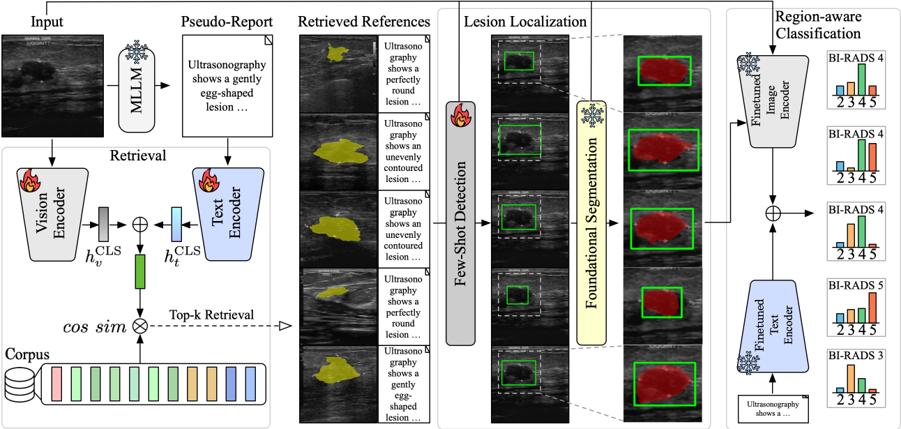

# [npj Digital Medicine 2026] B-RAD

### Interpretable multimodal retrieval augmented diagnosis for breast ultrasound with multinational clinical validation and reader study

> **TL;DR** B-RAD turns a single breast ultrasound image into an interpretable
> BI-RADS assessment by chaining four modules: BI-RADS-aware retrieval,
> retrieval-guided few-shot detection, foundational segmentation, and
> region-aware classification.



## Modules

| Module | Role | Environment |
|---|---|---|
| [B-RAD-CLIP](B-RAD/B-RAD-CLIP/README.md) | BI-RADS-aware image-text retrieval | torch + transformers |
| [B-RAD-Det](B-RAD/B-RAD-Det/README.md) | Retrieval-guided few-shot lesion detection | torch + timm |
| [B-RAD-Seg](B-RAD/B-RAD-Seg/README.md) | Bbox-prompted foundational segmentation (UltraSam) | mmdet / mmcv / mmpretrain |
| [B-RAD-FULL](B-RAD/B-RAD-FULL/README.md) | ROI-guided BI-RADS classification | torch + transformers |

The pipeline runs in four ordered stages:

| # | Stage | Input | Output |
|---|---|---|---|
| 1 | **B-RAD-CLIP** | query image | top-k BI-RADS-aware reference cases |
| 2 | **B-RAD-Det** | image + references | lesion box |
| 3 | **B-RAD-Seg** | image + box | lesion mask |
| 4 | **B-RAD-FULL** | image + ROI + text | BI-RADS probability |

## Layout

```text
.
├── B-RAD/                 the four modules + samples + scripts
│   ├── B-RAD-CLIP/        retrieval encoder + reference bank + infer_retrieval.py
│   ├── B-RAD-Det/         few-shot detector (train / evaluate)
│   ├── B-RAD-Seg/         UltraSam configs + infer_bbox.py
│   ├── B-RAD-FULL/        BI-RADS classifier (infer_birads.py)
│   ├── ckpts/             one checkpoint per module + download_weights.sh
│   ├── samples/           8 public BrEaST cases + sample.csv (metadata)
│   └── scripts/           inference_full.sh (end-to-end orchestration)
├── notebooks/             brad_inference_demo.ipynb (end-to-end, visualized)
└── assets/                overview figure
```

## Quick start

```bash
git clone https://github.com/snuh-rad-aicon/B-RAD && cd B-RAD
```

**1. Environments.** The demo needs two environments: B-RAD-CLIP, B-RAD-Det and
B-RAD-FULL share one (torch + transformers + timm), and B-RAD-Seg needs its own
(OpenMMLab / mmdet). The demo runs in the shared environment and calls the
segmentation step in the B-RAD-Seg environment.

```bash
# shared env for B-RAD-CLIP / B-RAD-Det / B-RAD-FULL / the notebook
conda env create -f environment.yml            # creates env "b-rad"  (or: pip install -r requirements.txt)
# transformers is capped below 4.48 on purpose; see the comment in requirements.txt

# segmentation env for B-RAD-Seg
conda create -n b-rad-seg python=3.8 -y && conda activate b-rad-seg
pip install torch==2.0.0 torchvision==0.15.1 --index-url https://download.pytorch.org/whl/cu118
pip install -r B-RAD/B-RAD-Seg/requirements.txt
mim install mmengine "mmcv>=2.0.0,<2.2.0" "mmdet>=3.3.0" "mmpretrain>=1.2.0"
```

**2. Checkpoints.** Download the inference weights into `B-RAD/ckpts/`:

```bash
bash B-RAD/ckpts/download_weights.sh
```

**3. Run the notebook (recommended).** `notebooks/brad_inference_demo.ipynb`
runs the whole pipeline on one sample and visualizes every stage (retrieved
references, predicted vs. ground-truth box with Dice/IoU, segmentation overlay,
BI-RADS probability, and the encoder's attention map). Open it with the `b-rad` env kernel, set `SEG_PY` and the
checkpoint paths in the setup cell (or as environment variables), and run all
cells.

**Alternative: headless script.** The same pipeline from the command line, on
one bundled sample (`QID=<uid>` picks another; default `usg_0059`):

```bash
export CLIP_PY=/path/to/b-rad-env/python       # torch + transformers
export SEG_PY=/path/to/b-rad-seg-env/python    # mmdet + mmcv + mmpretrain
bash B-RAD/scripts/inference_full.sh           # checkpoints default to B-RAD/ckpts/
```

## Samples

`B-RAD/samples/` bundles eight public [BrEaST-Lesions-USG](https://www.cancerimagingarchive.net/collection/breast-lesions-usg/)
cases (benign BI-RADS 2/3/4a, malignant 4b/4c/5), each with image, lesion mask, lesion
box, and MedGemma-generated report text. The end-to-end demo runs `usg_0059`
by default; four of the others are the references it retrieves, so the detector
gets its 4-shot supports without the full corpus on disk.
All Breast-Lesions-USG material redistributed here, the eight cases in
`B-RAD/samples/` and the 252 downscaled JPEG previews in
`B-RAD/B-RAD-CLIP/assets/reference_thumbs.npz`, is used under CC BY 4.0.
If you use it, please cite the dataset:

> Pawłowska, A., Ćwierz-Pieńkowska, A., Domalik, A., Jaguś, D., Kasprzak, P., Matkowski, R., Fura, Ł., Nowicki, A., & Zolek, N. A Curated benchmark dataset for ultrasound based breast lesion analysis. Sci Data 11, 148 (2024). https://doi.org/10.1038/s41597-024-02984-z.

## Data and checkpoints

Apart from the eight sample cases in `B-RAD/samples/`, original ultrasound images and
masks are **not** redistributed here. Public metadata (paths, reference lists, generated text) are available in the
[B-RAD dataset repository](https://huggingface.co/datasets/Subin94/B-RAD-Det-Dataset);
the images and masks are reconstructed from the original providers following
[B-RAD/B-RAD-Det/datasets/README.md](B-RAD/B-RAD-Det/datasets/README.md). Model checkpoints
live in `B-RAD/ckpts/`, one representative checkpoint per module
(`b_rad_clip.pt`, `b_rad_full.pt`, `b_rad_det.pt`, `UltraSam.pth`). Fetch them with
[B-RAD/ckpts/download_weights.sh](B-RAD/ckpts/download_weights.sh). They are gitignored.
`b_rad_full.pt` bundles the B-RAD-FULL encoder and its classification head in one file.

The MedGemma pseudo-reports are released as data (`medgemma_text.csv`, and
`B-RAD/samples/text/` for the bundled cases). MedGemma inference is **not** part
of this repository; the prompts and generation settings are described in the
paper's supplementary material.

## Citation

```bibtex
@article{jang2026interpretable,
  title     = {Interpretable multimodal retrieval augmented diagnosis for breast ultrasound with multinational clinical validation and reader study},
  author    = {Jang, Han and An, Subin and Jung, Sunghyun and Ji, Hye and Kim, Miran and Lee, Soochahn and Choi, Kyu Sung and Ha, Su Min},
  journal   = {npj Digital Medicine},
  year      = {2026},
  publisher = {Nature Publishing Group UK London},
  doi       = {10.1038/s41746-026-03272-3},
  url       = {https://doi.org/10.1038/s41746-026-03272-3}
}
```

## Acknowledgements

### Datasets

This work builds on openly accessible public breast-ultrasound (BUS) datasets and the PubMed Central Open Access (PMC-OA) corpus. Please cite the original authors and follow each provider's terms of use. The institutional clinical validation cohort is not publicly available due to patient-privacy regulations; access requests may be directed to the corresponding author subject to data-sharing agreements.

| Dataset | Description | Source |
|---|---|---|
| PMC-OA | Text-encoder pre-training corpus | https://www.ncbi.nlm.nih.gov/pmc/tools/openftlist/ |
| HiSBreast | Vietnam, B-mode BUS with BI-RADS labels | https://doi.org/10.17632/5c723rpwz2.2 |
| OASBUD | Poland, RF ultrasound with lesion metadata | https://zenodo.org/records/545928 |
| BUS-BRA | Brazil, B-mode BUS with BI-RADS + masks | https://zenodo.org/records/8231412 |
| BUSI-WHU | Wuhan University Hospital, BUS with expert masks | https://www.kaggle.com/datasets/orvile/busi-whu-breast-cancer-ultrasound-image-dataset |
| BUSI | B-mode BUS (benign/malignant/normal) with masks | https://scholar.cu.edu.eg/?q=afahmy/pages/dataset |
| BUS-UCLM | Spain, single-center BUS with pixel-wise masks | https://doi.org/10.17632/7fvgj4jsp7 |
| BrEaST-Lesions-USG | Poland, BI-RADS-labelled BUS with expert masks | https://www.cancerimagingarchive.net/collection/breast-lesions-usg/ |
| BUS-CoT | Multi-source public compilation with BI-RADS + chain-of-thought | https://doi.org/10.6084/m9.figshare.30838715 |
| BUS-STU (RD-AU) | China (First Affiliated Hospital of Shantou University), BUS with pixel-wise masks | https://github.com/xbhlk/STU-Hospital |
| UDIAT (Dataset B) | Spain, BUS with pixel-wise lesion annotations | http://www2.docm.mmu.ac.uk/STAFF/M.Yap/dataset.php |

### Baseline code and models

B-RAD builds on the following third-party code and pretrained models.

| Component | Use in B-RAD | Source |
|---|---|---|
| MedGemma | Report-text (pseudo-report) generation | https://github.com/google-health/medgemma |
| BiomedCLIP | Image-encoder backbone (B-RAD-CLIP, B-RAD-FULL) | https://huggingface.co/microsoft/BiomedCLIP-PubMedBERT_256-vit_base_patch16_224 |
| BioLinkBERT | Text-encoder tower | https://huggingface.co/michiyasunaga/BioLinkBERT-large |
| OWL-ViT | Open-vocabulary detection basis (B-RAD-Det) | https://github.com/google-research/scenic/tree/main/scenic/projects/owl_vit |
| UltraSam | Foundational segmentation (B-RAD-Seg) | https://github.com/CAMMA-public/UltraSam |
| MMDetection / MMEngine / MMPretrain | Detection framework for B-RAD-Seg | https://github.com/open-mmlab |

## License

Released under [CC BY-NC-SA 4.0](https://creativecommons.org/licenses/by-nc-sa/4.0/)
(see [LICENSE](LICENSE), with copyright and patent notices in [NOTICE](NOTICE)): **non-commercial use only**, with attribution, and
derivative works must carry the same license. The UltraSam-derived code and
configs in `B-RAD/B-RAD-Seg/` are under the same license (see
[B-RAD/B-RAD-Seg/LICENSE](B-RAD/B-RAD-Seg/LICENSE)). Other vendored code keeps
its original license, noted in the file headers. The released model checkpoints
are distributed under the same terms; third-party datasets remain subject to
their own terms.

### Patent notice

The methods in this repository are covered by Korean patent application
**10-2026-0096895**. No patent rights are granted by this license
(CC BY-NC-SA 4.0, Section 2(b)(2)). For commercial use or licensing, please
contact the corresponding author.

## Contact

For questions about the code, please open a GitHub issue or contact Han Jang (hanjang@snu.ac.kr).
